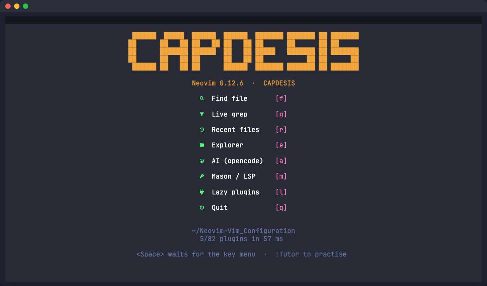
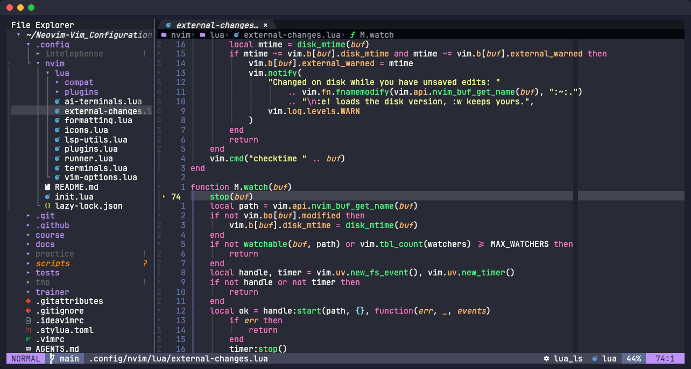
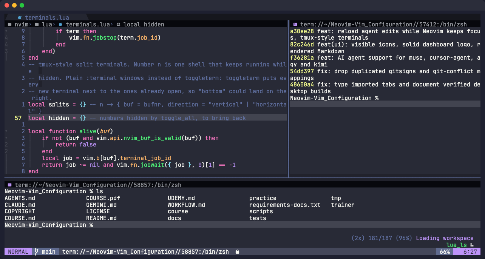
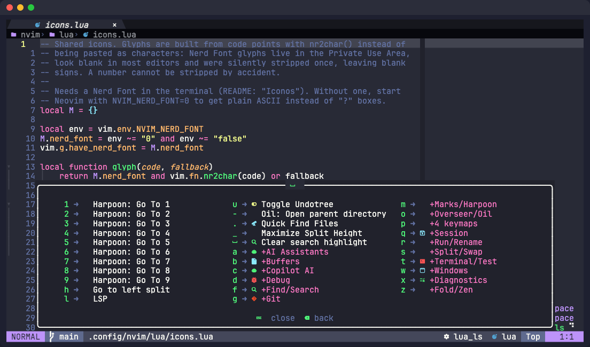
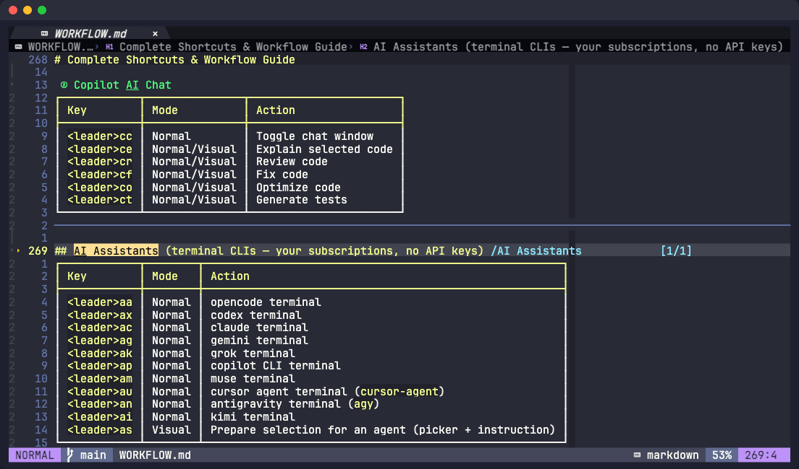

<div align="center">

# Neovim, Vim e IdeaVim · CAPDESIS

**Una configuración de Neovim para leer código, pedirle cambios a la IA y aprender Vim paso a paso.**
Mismos atajos en Neovim e IntelliJ/Android Studio. Windows, Linux y macOS.

[](https://github.com/chochy2001/Neovim-Vim_Configuration/actions/workflows/validate.yml)


[](LICENSE)



</div>

## ✨ Qué trae

| | |
|---|---|
| 🤖 **Agentes de IA** | opencode, Codex, Claude, Gemini, Grok, Copilot, muse, Cursor, Antigravity y kimi en `<leader>a*`. Lo que un agente cambia en disco se recarga solo, también desde otro panel de herdr o tmux, sin pisar tus cambios sin guardar. |
| 🧭 **Leer código** | Telescope, árbol de archivos, ruta y símbolo arriba (dropbar), 18 servidores LSP, Tree-sitter, Git con diff y blame. |
| 🖥️ **Terminales tipo tmux** | `<leader>tv` a la derecha, `<leader>th` abajo, con número para varias; `<leader>ta` las oculta sin matar el proceso. |
| 📝 **Markdown renderizado** | Títulos, tablas y bloques de código formateados dentro del buffer; `<leader>tm` vuelve al texto crudo. |
| 🧠 **IdeaVim unido** | `.ideavimrc` usa los mismos atajos; una prueba compara cada acción del IDE con su atajo de Neovim. |
| 🎓 **Curso y práctica** | [COURSE.md](COURSE.md) / [PDF](COURSE.pdf), [práctica en el navegador](https://chochy2001.github.io/Neovim-Vim_Configuration/) y un entrenador de escritorio; los ejercicios se validan contra Neovim real. |

## 📸 Así se ve

<table>
<tr>
<td width="50%"><br><sub><b>Código</b>: árbol (<code>&lt;leader&gt;pv</code>), ruta y símbolo, LSP en la barra de estado.</sub></td>
<td width="50%"><br><sub><b>Terminales</b>: <code>&lt;leader&gt;tv</code> a la derecha y <code>2&lt;leader&gt;th</code> abajo.</sub></td>
</tr>
<tr>
<td width="50%"><br><sub><b>Atajos</b>: pulsa Espacio y espera; el menú muestra cada grupo.</sub></td>
<td width="50%"><br><sub><b>Markdown</b>: tablas y títulos renderizados en el buffer.</sub></td>
</tr>
</table>

<sub>Capturas reales: Neovim corriendo en un terminal emulado con JetBrainsMono Nerd Font.</sub>

## 🚀 Empieza aquí

| Necesitas | Documento |
|---|---|
| 📘 Aprender Vim | [COURSE.md](COURSE.md) / [COURSE.pdf](COURSE.pdf) |
| ⌨️ Consultar atajos | [WORKFLOW.md](WORKFLOW.md), o `:Telescope keymaps` |
| 🤖 Trabajar con agentes y herdr | [WORKFLOW.md, AI Assistants](WORKFLOW.md#ai-assistants-terminal-clis-your-subscriptions-no-api-keys) |
| 🎬 Grabar el curso | [UDEMY.md](UDEMY.md) |
| 🔧 Entender el código | [.config/nvim/README.md](.config/nvim/README.md) |
| ✅ Pruebas y fuentes | [VALIDATION](docs/VALIDATION.md) / [SOURCES](docs/SOURCES.md) |
| 🌐 Practicar en el navegador | [Página de práctica](https://chochy2001.github.io/Neovim-Vim_Configuration/): 83 ejercicios paso a paso, validados contra Neovim real |
| 🏋️ Practicar sin Neovim | [trainer/README.md](trainer/README.md) |

## 📦 Requisitos

| Herramienta | Uso |
|---|---|
| [Neovim 0.12+](https://github.com/neovim/neovim/releases) | Editor |
| Git | Plugins y operaciones Git |
| Node.js 22+ mantenido | Servidores JS/TS, Prettier y Copilot |
| ripgrep (`rg`) y fd | Búsquedas; fd puede llamarse `fdfind` en Debian |
| Nerd Font | Iconos; por ejemplo JetBrainsMono NFM |
| tree-sitter CLI >= 0.26.1, curl, tar y compilador C | Compilar parsers |
| Python 3 | Scripts de validación |

### 🔣 Iconos

Los iconos salen como recuadros con `?` cuando el **terminal** no usa una Nerd
Font; Neovim no elige la fuente. Instala JetBrainsMono Nerd Font y selecciona
la variante **Mono** (`JetBrainsMono Nerd Font Mono`, abreviada NFM):

| Terminal | Dónde |
|---|---|
| Warp | Settings > Appearance > Text > Terminal font, o `font_name` en `[appearance.text]` de `~/.warp/settings.toml` |
| Windows Terminal | Perfil > Apariencia > Tipo de fuente |
| WezTerm, kitty, Ghostty, Alacritty | `font` / `font_family` en su archivo de configuración |
| GNOME Terminal, Konsole | Preferencias del perfil > Fuente personalizada |

herdr, tmux y SSH heredan la fuente del terminal que los contiene. Sin Nerd
Font, `NVIM_NERD_FONT=0 nvim` usa letras (`E W I H`) en signos y barra de estado.

Tree-sitter necesita un compilador en el entorno de Neovim. En Windows usa Visual
Studio con C++ y una **Developer PowerShell**; instalar el IDE no añade `cl` a
cualquier terminal. macOS: `xcode-select --install`; Linux: GCC/Clang.
El [README de nvim-treesitter](https://github.com/nvim-treesitter/nvim-treesitter#requirements)
pide instalar la CLI **fuera de npm**: usa el gestor del SO,
[binarios oficiales](https://github.com/tree-sitter/tree-sitter/releases) o,
con Rust instalado, `cargo install tree-sitter-cli --locked`.

El entrenador usa **Flutter 3.47.2 / Dart 3.13.2** en CI. Cada lenguaje necesita su
SDK. ctags, LazyGit, codelldb, cuentas de IA y swagger-ui-watcher son opcionales.

## 💻 Instalación

Clona en una carpeta dedicada y enlaza **su subcarpeta** `.config/nvim`.
Si el destino ya existe, respáldalo antes de crear el enlace. Estos comandos
no fuerzan su reemplazo.

### Windows / PowerShell

```powershell
winget install --id Neovim.Neovim --exact
winget install --id Git.Git --exact
winget install --id DEVCOM.JetBrainsMonoNerdFont --exact
git clone https://github.com/chochy2001/Neovim-Vim_Configuration.git "$HOME/Neovim-Vim_Configuration"
New-Item -ItemType Junction -Path "$env:LOCALAPPDATA/nvim" -Target "$HOME/Neovim-Vim_Configuration/.config/nvim"
nvim
```

Instala Node.js, ripgrep y tree-sitter según los requisitos. Selecciona
**JetBrainsMono NFM** en el terminal y abre una terminal nueva.

### macOS / Linux

```bash
git clone https://github.com/chochy2001/Neovim-Vim_Configuration.git ~/Neovim-Vim_Configuration
mkdir -p ~/.config
ln -s ~/Neovim-Vim_Configuration/.config/nvim ~/.config/nvim
nvim
```

Comprueba `nvim --version`: si el paquete de la distribución es anterior a 0.12,
usa la release oficial para tu arquitectura.

## 🔄 Primer arranque y actualizaciones

lazy.nvim instala plugins usando [lazy-lock.json](.config/nvim/lazy-lock.json).
Tree-sitter instala parsers faltantes. Mason instala los servidores configurados
al abrir archivos y los formateadores al quedar inactivo. Espera a que terminen.
Revisa fallos de red/compilación en `:Lazy`, `:Mason` y `:checkhealth nvim-treesitter`.
Arrancar no verifica por sí solo estas funciones.

- `:Lazy restore`: vuelve a las revisiones del lockfile.
- `:Lazy update`: actualiza plugins; revisa el lockfile y ejecuta las pruebas.
- `:TSUpdate`: actualiza parsers tras cambiar nvim-treesitter.
- `:Mason`: revisa herramientas externas. lazy-lock.json **no fija** sus versiones.
- `NVIM_OFFLINE=1`: desactiva descargas automáticas de plugins, parsers y herramientas.
  No bloquea la red de LSP/Git/IA ni órdenes explícitas de actualización.

Actualizar plugins no instala paquetes npm globales. Si necesitas Swagger,
instala `swagger-ui-watcher` explícitamente.

## ⌨️ Uso diario

Leader = **Espacio**. `<leader>ff` significa Espacio, f, f. Espacio dos veces limpia
la búsqueda. `<leader>f`, `b`, `r`, `gs`, `gc` también son prefijos y esperan
`timeoutlen=300`. Eso no equivale a dos acciones con la misma combinación.

1. `nvim archivo` abre un archivo; `nvim` abre el dashboard.
2. `<leader>ff` busca archivos, `fg` texto, `pv` abre el árbol.
3. `gd` definición, `K` ayuda, `<leader>rn` renombrar.
4. `<leader>fm` elige **un cliente adjunto**: none-ls con fuente aplicable, o un LSP.
5. `<leader>gs` Git; `gsa` cambia stage del hunk, `gc` commit, `gp` interfaz de push.

Dashboard: `f` archivo, `g` grep, `r` recientes, `e` explorador, `a` IA,
`m` Mason, `l` Lazy, `q` salir.

Completado: `Ctrl-Space`; selecciona una entrada antes de Enter. LuaSnip:
`Ctrl-j` avanza/expande, `Ctrl-k` retrocede. Copilot requiere autenticación.

Terminales: `<leader>tv` derecha, `<leader>th` abajo, `2<leader>tv` una segunda
terminal; `jj` vuelve a modo Normal y `Ctrl-h/j/k/l` cambia de ventana como en tmux.
`<leader>ta` oculta o muestra todas sin cerrar sus procesos, `<leader>tl` elige una.

Visual `<leader>as` captura la selección **antes** del selector y pide una
instrucción. Guarda el archivo y abre el agente a la derecha, en la raíz del repo,
ya trabajando con la instrucción, el archivo, las líneas y el código. Cuando el
agente guarda, el archivo se recarga. Con kimi (sin opción de prompt inicial) o con
CLIs `.cmd` de npm en Windows, el prompt queda en el portapapeles y en el registro
`a`: pégalo, revisa y envía. No se adivina el arranque con temporizadores.

## 🌐 Lenguajes y formato

| Lenguaje | LSP | Formato |
|---|---|---|
| Lua | lua_ls (Mason) | StyLua (Mason) |
| Dart/Flutter | dartls, gestionado por flutter-tools | dart format del SDK |
| Go | gopls (Mason), requiere Go | gofmt |
| Python | pyright (Mason) | Black en PATH |
| JS/TS | vtsls (Mason) | Prettier (Mason/proyecto) |
| Astro | astro (Mason) | Prettier **con prettier-plugin-astro en el proyecto** |
| JSON/YAML | jsonls/yamlls (Mason) | Prettier |
| C/C++ | clangd (Mason) | clang-format en PATH |
| Kotlin | kotlin_language_server (Mason; necesita un JDK) | Según servidor/proyecto |
| Swift | sourcekit-lsp en macOS | Según servidor/proyecto |
| HTML/CSS | html/cssls (Mason) | Prettier |
| PHP | intelephense (Mason) | Según servidor/proyecto |
| Bash/Dockerfile | bashls/dockerls (Mason) | Sin formateador externo configurado |
| TOML | taplo (Mason) | Taplo LSP |
| Rust | rust-analyzer de rustup (`rustup component add rust-analyzer`) | rustfmt a través de rust-analyzer |
| Markdown | Sin LSP | Prettier; se ve renderizado (`<leader>tm`) |
| SQL | Sin LSP configurado | Resaltado Tree-sitter |

Mason configura su PATH antes de comprobar ejecutables. Los servidores recién
instalados se configuran al terminar; no se habilitan otros automáticamente.
Dart tiene un solo dueño; `:LspRestartDart` actúa desde un buffer Dart.

none-ls no se adjunta a archivos de más de 50 KiB en disco; el formateo puede usar
el LSP adjunto. Solo Lua/JSON tienen formato al guardar. Se respetan las opciones
del proyecto (`.stylua.toml`, `.prettierrc`, `.clang-format`).
`:CheckFormatters` muestra fuentes y cliente elegido; no certifica dependencias
internas de Prettier.
Prettier respeta `.gitignore` y `.prettierignore`: un archivo ignorado puede
quedar sin cambios aunque el formateador esté instalado.

Opcionales: `uv tool install black` y `uv tool install clang-format`, por separado.
Los alias vacíos de Microsoft Store pueden no ser ejecutables para Neovim:
comprueba `:echo executable('python')` y usa una instalación real en PATH.

## ▶️ Ejecutar y depurar

`<leader>r`/`rf` ejecutan archivos **guardados** con el SDK disponible.
Los comandos protegen rutas con espacios/comillas; un fallo de compilación no
ejecuta el binario. Los binarios temporales quedan en el directorio temporal.
Java usa el modo archivo fuente (JDK 11+). TypeScript usa Deno o Node; su
compatibilidad depende de la sintaxis y versión del runtime.

`rp`/`or` abren tareas de Overseer. `rs` detiene el terminal actual o permite
elegir uno activo. `ten` usa vim-test; vimux solo dentro de tmux. DAP está
preparado para Flutter y codelldb cuando están disponibles.

## 🧠 IdeaVim y Vim clásico

Instala IdeaVim en el IDE y copia `.ideavimrc` a tu carpeta personal, conservando
antes cualquier archivo existente. Recarga con `:source ~/.ideavimrc`.
Sus acciones usan `nmap ... <Action>(id)`; consulta `:actionlist` si falta una.
Flutter requiere el plugin del IDE. Compartir prefijos no implica acciones idénticas.

`.vimrc` es **legado** y no se carga dentro de IdeaVim. Sin vim-plug conserva
la edición básica; para plugins, instala [vim-plug](https://github.com/junegunn/vim-plug)
en el runtime de Vim y ejecuta `:PlugInstall`.
Las dependencias de Vim clásico no comparten el lockfile de Neovim.
El arranque básico se comprueba por separado de las acciones reales de JetBrains.
Las copias instaladas de plugins, el historial de navegación y `.zshrc` son
archivos locales; no deben versionarse en este repositorio.

## 🇬🇧 English

Neovim 0.12+ configuration, Spanish course, legacy Vim and IdeaVim mappings,
and a Flutter desktop trainer. Clone outside the Neovim config directory and
link `.config/nvim`. Restore plugins with `:Lazy restore`, validate with
`python scripts/verify.py`. Full English shortcuts: [WORKFLOW.md](WORKFLOW.md).
Exact evidence/limitations: [docs/VALIDATION.md](docs/VALIDATION.md).

MIT. Copyright © 2026 CAPDESIS / chochy2001. [LICENSE](LICENSE).
