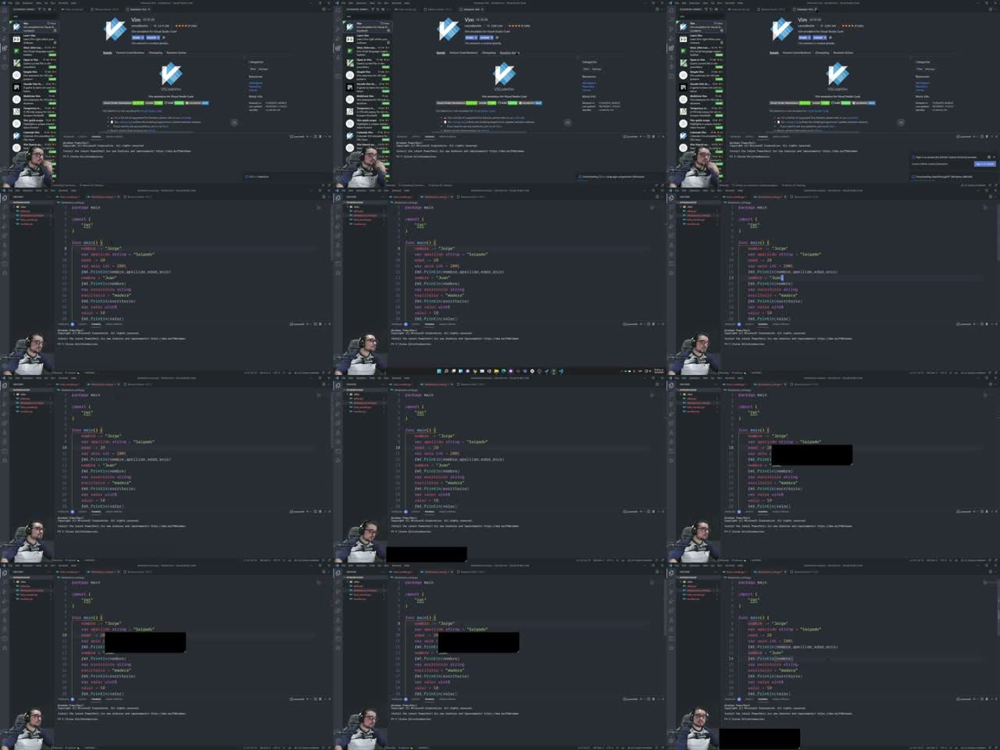
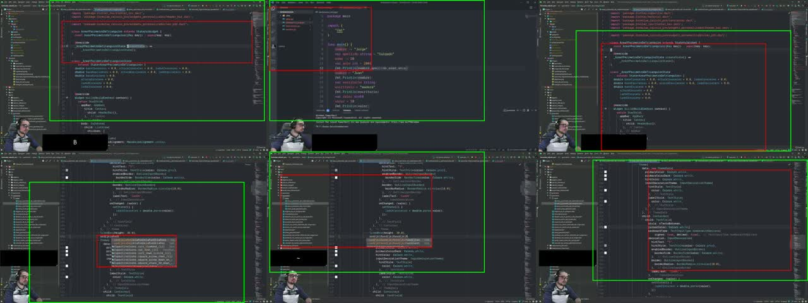
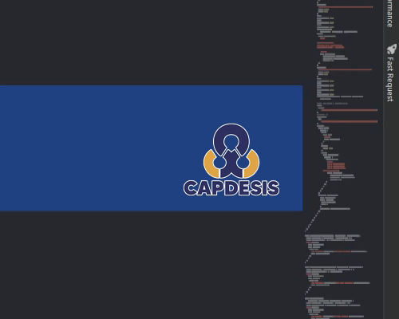
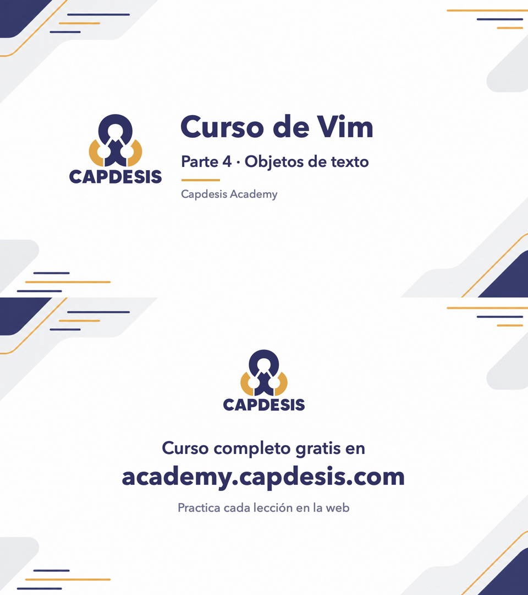

# Cómo editar los cursos

Guía para el operador y para cualquier agente que edite cursos de Capdesis Academy.
Probada con el curso de Vim (Resolve 21.1.0.17 Studio). Revisada: 2026-11-11.

Antes de empezar, lee también:

- `REQUISITOS-EDICION.md`: lo que pide el operador. Vale para todos los cursos.
- `BUENAS-PRACTICAS-RESOLVE.md`: Media, Cut, Edit, Fusion, Color, Fairlight y Deliver, con fuentes.
- `PLAN-CURSO-VIM.md`: ejemplo de plan de un curso (textos, módulos, clips).

Si un dato de otro documento contradice `REQUISITOS-EDICION.md`, manda REQUISITOS.
Si una regla técnica choca con REQUISITOS, se pregunta al operador (sección 18).

---

## Índice

1. Reglas básicas
2. Receta rápida para el próximo curso
3. Flujo, scripts y entradas
4. Reglas no negociables
5. Cortes
6. Zooms
7. Privacidad
8. Logo
9. Intro, cierre y música
10. Color
11. Audio
12. Render
13. Verificación
14. Reporte
15. API: qué sí y qué no
15b. Visor de teclas nuevo
15c. Animaciones Fusion
15d. Ronda 2: edición dinámica
16. Cumplimiento de REQUISITOS
17. Errores que ya cometimos y cómo evitarlos
18. Pendientes: decisiones y fallos de código
19. Fuentes

---

## 1. Reglas básicas

- `01-crudo/` es de solo lectura. Anotar tamaño y fecha al empezar (paso 0 de la receta).
- Los videos finales van a `editado/` (pedido del operador).
- No borrar archivos. Lo que se reemplaza se renombra o se aparta a `versiones-previas/`.
- No hacer commit, push ni subir nada a internet sin que lo pidan.
- En Resolve, no borrar líneas de tiempo: renombrarlas (`Parte 1 (v1 ...)`).

---

## 2. Receta rápida para el próximo curso

Ejecutar en orden. Las rutas se leen desde la carpeta del curso.

**Antes de nada:** todos los scripts tienen fija la ruta `~/Movies/Capdesis-Curso-Vim`.
Para un curso nuevo hay que cambiarla (ver 2.11). Y hay que comprobar los nombres de partes.

### 2.1 Variables

```bash
export CURSO=~/Movies/Capdesis-Curso-NUEVO
export H=$CURSO/03-analisis/herramientas
export PY=$CURSO/.venv/bin/python   # numpy, scipy y mlx_whisper (crear: python3 -m venv .venv && .venv/bin/pip install numpy scipy mlx-whisper)
export RESOLVE_SCRIPT_API="/Library/Application Support/Blackmagic Design/DaVinci Resolve/Developer/Scripting"
export RESOLVE_SCRIPT_LIB="/Applications/DaVinci Resolve/DaVinci Resolve.app/Contents/Libraries/Fusion/fusionscript.so"
export PYTHONPATH="$RESOLVE_SCRIPT_API/Modules/"
cd "$CURSO"
```

Los crudos deben llamarse `parte 1.mp4`, `parte 2.mp4`... (con espacio). Los scripts lo esperan así.

### 2.2 Paso 0: preparar carpetas y baseline

```bash
mkdir -p 01-crudo editado 03-analisis/{transcripts,audio/loudness,edicion,verificacion,silencios}
mkdir -p 03-analisis/frames/{revision-medium,verificacion-exports}
mkdir -p 04-davinci/{titulos/generadas,titulos/iconos,overlays,versiones-previas,render-resolve,render-relleno}
```

Baseline de los originales (ruta relativa a la carpeta del curso):

```bash
for f in 01-crudo/*.mp4; do echo "$f|$(stat -f %z "$f")|$(stat -f %m "$f")|$(stat -f %Sm "$f")"; done > editado/.baseline-originales.txt
```

Formato de cada línea: `ruta|tamaño|mtime|fecha`. Lo lee `reporte.py`.

Comprobar el formato de los crudos (rango de color y fps):

```bash
ffprobe -v error -show_entries stream=codec_name,width,height,r_frame_rate,pix_fmt,color_range -of compact=p=0 "01-crudo/parte 1.mp4"
```

### 2.3 Audio para análisis y transcripción (pasos 1)

El audio de análisis es 16 kHz mono PCM (formato de los WAV existentes).
Comando reconstruido de esos archivos: comprobar con ffprobe.

```bash
for p in 1 2 3 4 5; do
  ffmpeg -v error -y -i "01-crudo/parte $p.mp4" -vn -ac 1 -ar 16000 -c:a pcm_s16le "03-analisis/audio/parte-$p.wav"
  $PY -I $H/transcribir.py "01-crudo/parte $p.mp4" "03-analisis/transcripts/parte-$p"
done
```

Tarda varios minutos por parte. Ejecutar en segundo plano y mirar el log.

### 2.4 Plan de cortes y zooms (pasos manuales por agentes)

No hay script para estos archivos. Los hacen agentes leyendo la transcripción:

- `03-analisis/edicion/parte-N.json`: cortes propuestos (formato en la sección 3.2).
- `03-analisis/edicion/repeticiones-partes-X-Y.json`: repeticiones y trabas.
- `03-analisis/frames/zoom-plan.json`: zooms del plan (1.5x, y 2x solo si se pide).
- `04-davinci/timelapse-plan.json`: solo si el operador quiere acelerar silencios con acción (ronda 1). En la ronda 2 se corta todo silencio sin voz y no hay time-lapse (`items_timeline.py`).

### 2.5 Pantalla: clics y revisión de silencios (pasos 2 y 4)

```bash
$PY -I $H/detectar_zoom_clics.py      # -> 03-analisis/frames/zoom-clics.json
python3 -I $H/revisar_medium.py       # -> frames/revision-medium/ (solo para mirar)
```

### 2.6 Cortes y datos de línea de tiempo (pasos 3, 5 y 6)

```bash
python3 -I $H/plan_cortes.py          # -> edicion/aplicados-parte-N.json y plan-resolve.json
python3 -I $H/items_timeline.py       # -> 04-davinci/items-timeline.json
$PY -I $H/colocar_logo.py             # -> 04-davinci/logo-plan.json
```

En la salida de `plan_cortes.py`, cada parte debe mostrar `violaciones []`.

### 2.7 Intro y cierre (paso 7)

Antes, preparar:

- Fondo sin texto: `04-davinci/titulos/generadas/fondo-tarjeta.png` (generado con Codex).
- Logo: copiar el original a `04-davinci/overlays/capdesis_logo_original.png`.
- Iconos de apps en `04-davinci/titulos/iconos/`.
- Música: cortinilla propia solo en intro y cierre (sección 18).

```bash
bash $H/crear_capas.sh                # privacidad, logo, cortinilla (y tarjeta de clips)
bash $H/generar_titulos.sh            # -> titulos/intro-parte-N.mov y cierre.mov
.venv/bin/python -I $H/colocar_logo.py   # -> 04-davinci/logo-plan.json
```

### 2.8 Montaje en Resolve (paso 8)

Antes, en Resolve (proyecto del curso, 1920x1080, 60 fps, 48 kHz):

1. Importar `01-crudo/parte N.mp4` con el nombre `parte N.mp4`.
2. Importar `privacidad-androidstudio.mov`, `privacidad-vscode.mov`, `privacidad-navegador.mov`,
   `logo-capdesis.mov`, `intro-parte-N.mov` y `cierre.mov`.
3. Renombrar las líneas `Parte N` que ya existan (no borrarlas).

```bash
python3 $H/resolve_externo.py 1 2 3 4 5   # SIN -I: necesita PYTHONPATH de Resolve
```

Comprobar `04-davinci/construccion-timelines.json` por parte:
`fallos_set` = 0, `muestra_mal` = 0, `frames` = `frames_esperados`,
`voice_isolation` = true, `cdl` = [n, n].

### 2.9 Render y audio (pasos 9 y 10)

```bash
python3 $H/render_final.py            # SIN -I. Resolve abierto, página Deliver. Tarda.
python3 -I $H/finalizar_audio.py      # espera los renders y normaliza el audio
```

No forzar la salida de Resolve mientras procesa (sección 17, E8).
`finalizar_audio.py` espera como máximo 3 h y marca `cumple` en `finales.json`.

Silencios largos con acción (time-lapse), tras el primer render:

```bash
python3 -I $H/plan_timelapse.py       # -> 04-davinci/timelapse-plan.json (revisar fotogramas)
python3 -I $H/items_timeline.py && .venv/bin/python -I $H/colocar_logo.py
# renombrar las líneas "Parte N" en Resolve y repetir 2.8 y 2.9
```

### 2.10 Verificación (pasos 11 a 13)

```bash
$PY -I $H/verificar_exports.py        # ffprobe, transcripción, comparación, fotogramas
python3 -I $H/verificar_uniones.py    # energía en cada unión de corte
$PY -I $H/verificar_candidatos.py     # re-transcribe en ventana las diferencias de 3+ palabras
python3 -I $H/clips_promo.py          # clips (antes del reporte: el reporte los incluye)
python3 -I $H/reporte.py              # editado/REPORTE-EDICION.md
```

Comprobaciones a mano (con los comandos de abajo):

```bash
# Formato y duración de cada final
for f in editado/*.mp4; do
  ffprobe -v error -show_entries stream=codec_type,codec_name,width,height,r_frame_rate,sample_rate:format=duration,bit_rate \
    -of compact=p=0 "$f"
done

# Zoom máximo por parte (debe ser 1.5; la parte 2 tiene 2.0 solo en su barra inferior)
python3 -I -c 'import json
d = json.load(open("04-davinci/items-timeline.json"))
for p, v in d.items():
    z = [r for r in v["video"] if r[3]]
    print(p, "zoom max", max(r[3][0] for r in z))'
```

Clips: `clips_promo.py` usa `03-analisis/edicion/clips-promo.json` (rangos elegidos por un agente
leyendo la transcripción, sin cruzar cortes ni tramos acelerados). Audio a -14 LUFS.

### 2.11 Lo que hay que adaptar por curso

| Qué | Dónde | Notas |
|---|---|---|
| Carpeta del curso | `BASE` en todos los scripts; `B` en `generar_titulos.sh` | `grep -l "Capdesis-Curso-Vim" $H/*` |
| Número de partes | lista `[1, 2, 3, 4, 5]` / `range(1, 6)` en 18 scripts (`grep -l "range(1, 6)\|\[1, 2, 3, 4, 5\]" $H/*`); `NAMES` en 12 | Cambiar todos a la vez (pendiente: un único `curso.json`, sección 18) |
| Nombres de partes | `NAMES` en 12 scripts; `_N` en `finalizar_audio.py`; `TITULOS` en `generar_titulos.sh` | Mismos nombres que en `editado/` |
| Títulos de intro | `generar_titulos.sh`: "Curso de ...", "Capdesis Academy", "Parte N · tema" | Cierre: `t-cierre1..3` |
| Herramientas por parte | `HERRAMIENTAS` en `generar_titulos.sh`; iconos `chip-*.png` | Solo apps que salen en la grabación |
| Apps y zonas de privacidad | `APPS` en `items_timeline.py` y `colocar_logo.py`; `PATCH` en `colocar_logo.py` | Tiempos en segundos. Deben coincidir con los overlays `privacidad-*.mov` |
| Tomas erróneas y trabas | `WRONG`, `STUTTER`, `NO_UTIL` en `plan_cortes.py` | Tiempos medidos con `energia.py` |
| Posiciones del logo | `CANDS` y `DEF` en `colocar_logo.py`; `LOGO_DEF` en `resolve_externo.py` | Deben coincidir con el overlay del logo (120 px en 1920x1080) |
| Duración intro, lista y cierre | `04-davinci/estructura.json` (`intro` 240, `lista` 300, `pre` 540, `outro` 240, `post` por parte); OJO: `INTRO`/`OUTRO` = 240 siguen fijos en `resolve_externo.py:30` y `-t 4` en `generar_titulos.sh` | Cambiar `estructura.json` y esos dos a la vez |
| Inicio de la línea | `MarkIn` 216000 en `render_final.py` | Igual al inicio de "Parte 1" (01:00:00:00 a 60 fps) |
| Tarjeta promo | `titulos/tarjeta-promo-3s.mp4` | 3 s, con la URL de la academia |

### 2.12 Lista de verificación final: sin falsos positivos

- [ ] `plan_cortes.py`: `violaciones []` en todas las partes.
- [ ] `construccion-timelines.json`: fallos y muestras malas en 0; CDL y Voice Isolation correctos.
- [ ] ffprobe de cada final: 1920x1080, 60/1, H.264, AAC 48000 Hz, duración = (total_frames + pre + post de la parte) / 60 ± 0.15 s (`estructura.json`).
- [ ] `finales.json`: -16 LUFS ± 0.5 y pico real ≤ -1.5 dBTP.
- [ ] `verificar_exports`: sin contenido perdido ni palabras cortadas; `toma_erronea_presente` todo en false.
- [ ] `verificar_uniones`: sin "REVISAR", o cada punto revisado a mano.
- [ ] Fotogramas (10 por parte + 1 por zoom) mirados a mano: sin rutas ni correos, logo visible, texto nítido.
- [ ] Zoom máximo 1.5 (salvo la ventana de 2x que el plan pide).
- [ ] El logo no tapa nada en ningún segmento de `logo-plan.json`.
- [ ] Voice Isolation activo después de reabrir el proyecto.
- [ ] Música: decidida (sección 9 y 18).
- [ ] `01-crudo/` sin cambios: el reporte dice "intactos".
- [ ] Revisión por al menos 2 agentes, sin darles el veredicto.
- [ ] `REPORTE-EDICION.md`: APROBADO solo si todas las comprobaciones dan OK; pendientes listados.
- [ ] Esta guía actualizada con lo nuevo (sección 17).

Regla: un "True" o un "OK" de un script no basta. Debe verse en ffprobe, en la transcripción
o en los fotogramas.


### 2.13 Ronda 2: reconstrucción completa en orden (`reconstruir_todo.sh`)

Es la receta real con la que salieron los finales de la ronda 2. Antes de lanzarla deben existir (los hacen agentes o pasos manuales):

1. Transcripción (`transcribir.py`) y máscara de voz (`mascara_voz.py`, `revisar_regiones_sin_palabras.py`).
2. Análisis por parte con agentes → `03-analisis/edicion/analisis-v2-parte-N.json` (comandos, marcas, lugares, tomas malas, cámara).
   Revisar a mano cada `corrige_audio` y fijarlo en `03-analisis/edicion/correcciones-tarjetas.json` (E44).
3. `aplicar_tomas_v2.py`, `detectar_linea_comandos.py` (OCR de `:w`, `/texto`), `medir_gutter.py`, `buscar_cajas_negras.py` (crudo).
4. Visor de teclas validado (sección 15b) y demos validadas en Neovim (`validar_demos_vim.py --v2`).

Después, con Resolve abierto en el proyecto:

```bash
zsh 03-analisis/herramientas/reconstruir_todo.sh clips-v6 v4   # SIEMPRE carpetas nuevas (E34)
```

El script hace: items → logo → capas de teclas → plan de tarjetas → capas de tarjetas → composiciones Fusion → **pausa manual**:
renderizar `fusion-todas-v2.mov` en Deliver (ProRes 4444 con alfa, E19) → clips de animación → estructura → renombrar
las líneas viejas → montaje → render → audio → los 7 verificadores → reporte.

- Corre TODOS los verificadores aunque uno falle, guarda cada log en `03-analisis/verificacion/ultimo-reconstruir/` y solo
  escribe "TODO LISTO" si todos salen con código 0 y el reporte está APROBADO. Si no: "NO LISTO. Fallaron: ...".
- No editar el script mientras corre (E43). Lanzarlo en segundo plano: tarda 1.5-2 h.
- Antes de la reconstrucción completa: render corto de una parte con color, capas y tarjetas comprobados (E47).

---

## 3. Flujo, scripts y entradas

Todos los scripts están en `03-analisis/herramientas/`.

| Paso | Script | Entrada → salida |
|---|---|---|
| 1 | `transcribir.py` | `parte N.mp4` → `transcripts/parte-N.json` y `.txt` |
| 2 | `revisar_medium.py` | `edicion/parte-N.json` (medium) → `frames/revision-medium/` (solo revisión) |
| 3 | `plan_cortes.py` | plan + repeticiones + transcripción + WAV → `edicion/aplicados-parte-N.json`, `plan-resolve.json` |
| 4 | `detectar_zoom_clics.py` | `01-crudo/` → `frames/zoom-clics.json` |
| 5 | `items_timeline.py` | `plan-resolve` + `zoom-plan` + `zoom-clics` → `04-davinci/items-timeline.json` |
| 6 | `colocar_logo.py` | `items-timeline.json` + `01-crudo/` → `04-davinci/logo-plan.json` |
| 7 | `generar_titulos.sh` | fondo + logo + textos + iconos + música → `titulos/intro-parte-N.mov`, `cierre.mov` |
| 8 | `resolve_externo.py` | `items-timeline` + `logo-plan` + títulos → líneas "Parte N" en Resolve |
| 9 | `render_final.py` | líneas "Parte N" → `04-davinci/render-resolve/<nombre>.mp4` (nombres de `NAMES`) |
| 10 | `finalizar_audio.py` | renders → `editado/<nombre>.mp4` y `audio/loudness/finales.json` |
| 11 | `verificar_exports.py` | `editado/` + transcripción + aplicados → verificación y fotogramas |
| 12 | `verificar_uniones.py` | `editado/` + `items-timeline.json` → `verificacion/uniones.json` |
| 13 | `reporte.py` | todo lo anterior → `editado/REPORTE-EDICION.md` |
| 14 | `clips_promo.py` | `editado/` + `clips-promo.json` → `editado/promo/` |

### 3.1 Scripts auxiliares (no tienen paso propio)

| Script | Para qué |
|---|---|
| `comparar_transcripciones.py` | Lo llama `verificar_exports.py`. Uso: `<parte> <export.json>` |
| `energia.py` | RMS en ventanas de 20 ms: `python3 -I energia.py <wav> <t0> <t1>` |
| `revisar_medium_lib.py` | Librería de actividad de pantalla. La usa `plan_cortes.py` |
| `texto_png.swift` | Texto a PNG con CoreText. Lo llama `generar_titulos.sh` |
| `resolve_build.py` | Dentro de Resolve (MCP, `run_script_unsafe`, límite 60 s). Fases: crudo, base, zoom, acabado |

### 3.2 Pasos sin script (no archivados en el repo)

- Plan de cortes y repeticiones: lo hacen agentes. Formato abajo.
- `zoom-plan.json` y `timelapse-plan.json`.
- Overlays `privacidad-*.mov` y `logo-capdesis.mov` (sección 18).
- Cortinilla de audio, fondo de Codex, iconos (`.icns` a PNG con `sips`).
- `clips-promo.json`.

Formato de `edicion/parte-N.json` (lo que leen `plan_cortes.py` y `revisar_medium.py`):

- Arriba: `part`, `raw_duration_s`.
- `items`: una entrada por corte, con `id`, `type`, `confidence` (high, medium o low),
  `in`, `out` (segundos), `in_tc`, `out_tc`, `dur`, `reason`. Opcional: `gap_full`.

Formato de `repeticiones-partes-X-Y.json` (una lista):

- `parte`, `id`, `quitar_texto`, `t_ini`, `t_fin` (segundos), `decision` (`cortar` o `duda`),
  `antes`, `despues`, `queda`, `motivo`.

### 3.3 Python por script

| Scripts | Python | Por qué |
|---|---|---|
| `transcribir`, `colocar_logo`, `detectar_zoom_clics`; `verificar_exports` (llama a `transcribir`) | `$PY` (con `-I`) | Usan numpy o mlx_whisper. El `python3` del sistema no tiene numpy |
| `resolve_externo`, `render_final` | `python3` SIN `-I` | Necesitan `PYTHONPATH` de Resolve, y `-I` lo ignora |
| `leer_teclas`, `mascara_voz`, `revisar_regiones_sin_palabras`, `buscar_cajas_negras`, `verificar_candidatos`, `verificar_capas`, `plan_animaciones(_v2)` | `$PY -I` | numpy, scipy o mlx |
| `animaciones_fusion`, `estructura_fusion`, `prueba_fusion` | `python3` SIN `-I` | Módulo de Resolve (Fusion) |
| Resto | `python3 -I` | Solo librería estándar. Si dudas, mira los `import` de la cabecera |

---

## 4. Reglas no negociables

- Nunca cortar dentro de una palabra: margen de más de 0.1 s a cada lado.
- No quitar nada que enseñe. Ante la duda, no cortar y anotarlo.
- Sin falsos positivos: nada es "bueno" sin render real, ffprobe, transcripción y fotogramas.
- Si una herramienta devuelve "True" pero no se ve el efecto, no cuenta.

---

## 5. Cortes

### 5.1 Silencios

Clasificación de cada silencio (la hacen los agentes):

- **high**: silencio con pantalla quieta. `plan_cortes.py` lo aplica sin mirar la pantalla.
  La comprobación de pantalla es del agente (pendiente de automatizar).
- **medium**: `plan_cortes.py` mide la pantalla cada 0.25 s. Fotograma de 192x108 en gris.
  Se ignoran la barra de título (y < 3) y la webcam con el overlay (x < 78 e y ≥ 60).
  Cuenta como acción un cambio de más de 25 niveles en más de 15 píxeles entre dos fotogramas.
  Según el resultado:
  - Pantalla quieta: se corta y queda 0.4 s de pausa.
  - Hay acción (escribe, cursor, resultado): se cortan solo los tramos quietos de al menos 0.5 s,
    a más de 0.75 s de cualquier acción. Cada acción conserva unos 0.75 s de margen a cada lado.
- **low**: solo se reportan.

Bordes: los cortes se ponen en silencio real medido con energía de audio.
Un silencio de borde es de al menos 60 ms por debajo de -45 dBFS (ventanas de 20 ms).
Whisper no marca bien los bordes.

Para mirar un silencio dudoso: `revisar_medium.py` guarda 3 fotogramas (inicio, mitad, fin).
Son para ver. La decisión usa todos los fotogramas cada 0.25 s.



### 5.2 Tomas erróneas

- Las que el orador pide cortar ("eso se corta") o que repite mal.
- Los bordes van en el silencio medido con energía (no en los tiempos de Whisper).
- En Vim: 2 tomas en `WRONG` de `plan_cortes.py`, con tiempos medidos.

### 5.3 Repeticiones y trabas

Cuando repite algo por haberlo dicho mal, se deja la última versión buena.

1. Agentes leen la transcripción y proponen `cortar` o `duda`.
2. Solo se aplican los `cortar` que pasan **tres filtros** (en `plan_cortes.py`):
   - Hay silencio real (sección 5.1) en los dos bordes.
   - Las palabras dentro del corte son **exactamente** las previstas
     (sin tildes ni signos, en minúscula). Si el silencio más cercano incluye palabras de más, no se corta.
   - La pantalla no cambia dentro del tramo (cambio mayor de 15 píxeles entre fotogramas de 0.25 s).
3. Lo demás va al reporte como "no aplicado".

Repasos a propósito (repetir un comando para que se vea): los agentes los marcan `duda`
o no los proponen. Ningún filtro los detecta solo.

En Vim se propusieron 35 cortes `cortar` y pasaron 12 (más 3 trabas en `STUTTER`).
Los otros quitaban una palabra de más o tapaban una acción.

### 5.4 Silencios largos con acción (time-lapse)

**No aplicar** hasta que el operador decida (sección 18). REQUISITOS dice "no se corta;
como mucho la pausa queda en 1.5 s". Acelerar no cumple eso.

Lo que hace hoy el código, por si se aprueba: un tramo de más de 8 s sin voz con acción se
acelera 2x (menos de 20 s) o 3x (más de 20 s), tomando 1 de cada 2 (o 3) fotogramas.
`items_timeline.py` lo lee de `04-davinci/timelapse-plan.json`. Ese plan incumple su propia regla
en 6 de sus 13 tramos (ver sección 17, E13).

### 5.5 Revisión de audio por un agente (después del primer render)

En Vim, el revisor de audio encontró 7 repeticiones y tomas erróneas que los filtros automáticos
habían descartado (p. ej. un monólogo de duda en la parte 5, un falso inicio en la parte 4 que
Whisper no transcribió). Se añaden en `03-analisis/edicion/repeticiones-qa.json`:

- Mismos filtros de silencio en los bordes y de palabras exactas.
- `forzar_pantalla: true` solo si la acción en pantalla se repite después (no se pierde nada).
- `inicio_de_parte: true` para cortar un falso inicio desde el fotograma 0.

### 5.6 Whisper confunde

| Audio | Whisper escribe |
|---|---|
| Esc | "Skip" |
| IdeaVim | "BIM" |
| JetBrains | "JETURINGS" |

`comparar_transcripciones.py` ya traduce estos tres.

---

## 6. Zooms

### 6.1 Dos tipos

| Tipo | Escala | Rampa |
|---|---|---|
| Plan (texto pequeño, petición) | 1.5x | 1.0 s |
| Plan 2x (solo si se pide) | 2x | 1.5 s |
| Clic, menú o acción | 1.25x | 0.8 s |

Las rampas se miden en tiempo del video **final**. En la primera versión se medían en tiempo del
original: en tramos acelerados (2x/3x) la rampa se comprimía y el zoom "saltaba". Con 0.5 s el
revisor visual lo vio brusco: por eso ahora son 0.8-1.5 s.

Los del plan mandan. Un zoom de clic no se solapa con uno del plan ni cruza un corte.
Regla del operador: no pasar de 1.5x (2x solo en la barra inferior de la parte 2).

### 6.2 Cómo se detectan los clics (`detectar_zoom_clics.py`)

- 5 fotogramas por segundo (cada 0.2 s), 384x216, en gris.
- Se ignoran: la barra de título (y < 30 px) y la zona x < 780 px, y ≥ 690 px
  (webcam y overlay de teclas, en píxeles de 1920x1080).
- Evento: más de 30 píxeles cambian más de 20 niveles de gris, y la caja del cambio ocupa
  como mucho el 40 % del cuadro (así se descarta el scroll).
- Eventos a menos de 1.5 s se agrupan si caben en la ventana de zoom.
- Zoom: un grupo de al menos 2 eventos que dura 2.5 s o más, contando 0.4 s antes y 1.2 s después.



### 6.3 Cómo se hace en Resolve

- La API **no tiene keyframes** de Transform.
- Cada fotograma de la rampa es un clip propio con su ZoomX, ZoomY, Pan y Tilt
  (`items_timeline.py` lo calcula; `resolve_externo.py` lo aplica).
- Curva suave: `s = 3u² − 2u³`.
- Pan en píxeles. Tilt positivo = arriba.
- Para centrar `[x, y, w, h]` a escala `S`:

```
Pan  = -(cx - 960) * S
Tilt =  (cy - 540) * S
```

- Zooms seguidos (separados menos que sus dos rampas) se **encadenan**: la cámara se desplaza
  de un encuadre al otro sin alejarse y volver a acercarse (evita el efecto "bombeo").
- Cada zoom tiene sitio para su rampa completa: si la ventana es corta, se alarga
  (sin invadir el siguiente).
- Control automático: `items_timeline.py` imprime el salto máximo de escala por fotograma.
  Debe ser ≤ 0.013 (1.5x) o ≤ 0.017 (2x). Pan/Tilt ≤ ~8 px por fotograma (≤ 24 en el 2x).
- `SetProperty({...})` con diccionario es 4 veces más rápido que 4 llamadas.
- Con miles de clips, usar el script externo: el MCP corta a los 60 s.
- Montar en bloques de ~1000 clips (`append_chunks` en `resolve_externo.py`).

### 6.4 Calidad

- Los crudos de Vim son 1920x1080. El zoom amplía píxeles: máximo 1.5x.
- Si se graba en 2K o 4K y se entrega en 1080p, se puede hacer más zoom sin perder nitidez.
- En móvil (390 px de ancho) el código de una IDE a 1080p **no se lee** ni con 1.5x (revisión
  visual de Vim). Para los próximos cursos: fuente del editor ≥ 18 pt, tema de alto contraste,
  grabar a 2K/4K, o mostrar las teclas en pantalla grande.

---

## 7. Privacidad

- Tapar rutas locales (F:\...), marcadores del navegador, correos, tokens y proyectos de clientes.
- Capa V2 con parches opacos, por aplicación:
  - `as` = Android Studio, `vs` = VS Code, `br` = navegador.
- Tramos de app por tiempo de origen: `APPS` en `items_timeline.py` y en `colocar_logo.py`.
- Zonas tapadas: `PATCH` en `colocar_logo.py`, en píxeles de 1920x1080 (x, y, ancho, alto).
  Deben coincidir con los overlays `privacidad-*.mov` (que hoy no tienen script, ver sección 18).
- La capa V2 lleva el mismo zoom que V1, clip a clip, para que el parche se mueva con la imagen.
- `drawbox` sobre rgba necesita `replace=1`; sin eso el parche sale invisible (sección 17, E4).
- Verificación: mirar un fotograma de cada tramo de app y de cada zoom.
  Ni una ruta, correo ni token debe verse.

---

## 8. Logo

- Archivo: `~/Documents/Apps/capdesis-academy/web/public/images/logo/capdesis_logo.png`.
  Es idéntico a `04-davinci/overlays/capdesis_logo_original.png` (comprobado con `cmp`).
- Se usa **tal cual**: sin recolorear, sin halo, sin brillo, sin sombra.
  El operador rechazó recolorear y el halo (sección 17, E10). Brillo y sombra quedan prohibidos igual.
- Las líneas blancas finas entre las formas son parte del diseño original.
- Si contrasta poco, se cambia la posición, no el logo.



No usar: `imagenes/logo-opciones-RECHAZADO-no-usar.png` ni `overlays/logo-capdesis-halo-120.descartado.png`.

### 8.1 Posición: por defecto arriba a la derecha, se mueve solo si tapa

- Por defecto: arriba a la derecha (1784, 8), cuadro de 120 px en 1920x1080.
- `colocar_logo.py` revisa cada 0.5 s del video final:
  1. Calcula qué parte del original cae bajo el logo, con el zoom de ese momento.
  2. Mide la "tinta" (texto o iconos) en 10 posiciones candidatas: x en {1784, 1650}, y en {8, 112, 480, 820, 940}.
  3. Elige con penalización por cambio (0.08), para que no salte.
- En Resolve, el logo se mueve con Pan/Tilt y tiene un fundido corto (10 a 15 fotogramas) al cambiar.
- Vim: fijo arriba a la derecha tapaba del 9 al 14 % de la tinta media (`logo-plan.json`).
  Con la colocación, la tinta media queda por debajo del 0.1 %.
- Las candidatas (1650, y) están a la derecha pero no en la esquina. Ver sección 18.

---

## 9. Intro, cierre y música

- Intro de 4 s: logo, "Curso de Vim" (o el del curso), "Parte N · tema", "Capdesis Academy",
  y "Grabado en ..." con las herramientas de esa parte.
- Cierre de 4 s: "Curso completo gratis en academy.capdesis.com".
- Fondo: generado con Codex (`codex exec`), sin texto ni marcas de agua.
  Archivo: `titulos/generadas/fondo-tarjeta.png` (RGB, sin alfa).
- Textos con CoreText (`texto_png.swift`, Avenir Next).
- Iconos de las tecnologías en la intro: solo de fuentes seguras.
  - Apps instaladas (`.icns` a PNG con `sips`), uso nominativo: Android Studio, JetBrains.
  - Ronda 2 (el operador pidió iconos de marca): SVG de Simple Icons (licencia CC0, copia en `titulos/iconos/marcas/LICENSE.md`),
    descargados una vez y guardados en `titulos/iconos/marcas/`. Uso nominativo (la marca sigue siendo de su dueño). Solo de esa fuente
    o de apps instaladas; si la marca no está (VS Code, Windows, IdeaVim, Vi), solo el nombre con una barra de su color. Nunca un logo inventado ni redibujado.
  - El texto "Grabado en ..." se ajusta a lo que sale en cada parte. Nada de herramientas que no aparecen.
- Fundidos con `SetFades` (fiable por API).
- **Música**: REQUISITOS dice "sin música". Hoy `generar_titulos.sh` pone en intro y cierre
  `musica-cortinilla-4s.wav`, un sonido sintetizado con ffmpeg. Por defecto: sin música.
  Si el operador no aprueba la cortinilla, cambiar ese audio por `titulos/silencio-4s.wav`
  (sección 18).
- Para regenerar tarjetas con Resolve abierto: generar con otro nombre, mover la anterior a
  `versiones-previas/`, renombrar y `RelinkClips`. Nunca sobrescribir un archivo mientras se renderiza.



---

## 10. Color

- CDL suave en V1: slope 1.04, offset -0.01, saturación 1.08 (`resolve_externo.py`).
- Comprobar en un render que el texto sigue nítido y el blanco no se quema.
- `ExportCurrentFrameAsStill` solo da V1 de la página Color. Para el compuesto, render corto.

---

## 11. Audio

| Uso | Integrado | Pico real |
|---|---|---|
| Todo el material del curso | -16 LUFS | ≤ -1.5 dBTP |
| Clips de YouTube | -16 LUFS (REQUISITOS); el código usa -14 | ≤ -1.5 dBTP |

Clips de YouTube: decidir con el operador (sección 18). Hasta entonces, REQUISITOS manda.

- Voice Isolation 25 en A1 (reducción de ruido ligera).
- Se pierde al reabrir el proyecto: reaplicar y guardar antes del render.
  Comprobar `GetVoiceIsolationState` tras reabrir.
- `NormalizeAudioLevel` devolvió True sin cambiar la sonoridad. No se usa.
- Normalizar con `ffmpeg loudnorm` en dos pasadas, copiando el video (`finalizar_audio.py`):
  - Objetivo de pico -2.0 dBTP. Si el pico real queda por encima de -1.5, se reintenta
    con -2.5, -3.0, -3.5 y -4.0. Se acepta cuando el pico es ≤ -1.5 y la sonoridad está a ±0.5 LU de -16.
  - Medir el archivo final, no el intermedio.
- Audio del final: AAC 48 kHz a 192 kb/s (`finalizar_audio.py`).
  Clips de YouTube: AAC a 256 kb/s (`clips_promo.py`).
- Sin música (ver sección 9).
- Escuchar o transcribir el resultado: que tenga sentido y que no se haya cortado de más.

---

## 12. Render

- `render_final.py` fija H.264, 1920x1080, 60 fps y AAC 48 kHz. El perfil H.264 no se fija en el código.
- `finalizar_audio.py` deja el audio final en AAC a 192 kb/s.
- **El bitrate de vídeo no está controlado.** `VideoQuality` (16000 en `render_final.py`)
  no lo fija: sale VBR. Medir `bit_rate` con ffprobe y reportarlo.
- El primer trabajo de cada tanda sale **sin video**: el relleno de 5 fotogramas
  (`render-relleno/`) va primero. Ver sección 17, E1.
- `StartRendering` no bloquea: esperar a que `IsRenderingInProgress()` sea falso.
- Renders que fallan o se quedan: revisar `GetRenderJobStatus`. `render_final.py` solo imprime el estado;
  no verifica nada.
- El relleno usa `MarkIn` 216000 (01:00:00:00 a 60 fps). Si el timeline no empieza ahí, cambiarlo.

---

## 13. Verificación

1. ffprobe: 1920x1080, 60 fps, H.264, AAC 48 kHz, y duración = (fotogramas del plan + 480) / 60 ± 0.15 s.
2. Transcribir el export y compararlo con el original (`verificar_exports.py`).
   - Palabras quitadas a propósito: OK.
   - Contenido perdido o palabra cortada a medias: ERROR.
3. 10 fotogramas repartidos + uno por zoom (`verificar_exports.py`).
4. LUFS y pico real del final (`finales.json`).
5. Uniones de corte: `verificar_uniones.py`. Si hay voz en ambos lados de la unión (-40 dBFS
   en ±40 ms), se marca REVISAR.
6. Diferencias de 3+ palabras: `verificar_candidatos.py` las vuelve a transcribir en ventana corta.
   Whisper en archivos de 15 min **se salta trozos** (en Vim parecía que faltaban 96 palabras y estaban todas).
   Si aún hay duda, transcribir el mismo fragmento del original y del final: si salen iguales, es el mismo audio.
7. Revisión por varios agentes, sin darles la conclusión: pasarles el archivo, la transcripción,
   los fotogramas y una lista de comprobación. No el veredicto. Guardar sus respuestas.

---

## 14. Reporte

`editado/REPORTE-EDICION.md`, generado por `reporte.py`, por parte:

- Duración antes y después.
- Cortes por tipo, zooms, LUFS.
- APROBADO o NO APROBADO, con el motivo (cada comprobación de la tabla).
- Pendientes y dudas para el operador (repeticiones no cortadas, sugerencias bajas).

`reporte.py` funciona desde cualquier carpeta y mide todo con ffprobe.

---

## 15. API: qué sí y qué no

| Sí | No |
|---|---|
| Zoom, Pan, Tilt fijos por clip | Keyframes de Transform |
| `SetCDL` | Ganancia y FX de Fairlight |
| `SetFades` | Leer la curva de un keyframe |
| `Get/SetVoiceIsolationState` | Cuadros de V2/V3 sin render |

---

## 15b. Visor de teclas nuevo

La grabación trae una caja negra (herramienta de Windows) con las teclas. Se ve mal y se sustituye.

| Paso | Script | Salida |
|---|---|---|
| 1. Dónde está la caja | `localizar_caja_teclas.py N` | posiciones (en Vim: A abajo-izquierda, B abajo-centro en la parte 1) |
| 2. Estados por fotograma | `medir_teclas.py N A\|B` | `03-analisis/teclas/parte-N/X/estados.json` + un PNG por texto distinto |
| 3. OCR local | `ocr_teclas.swift` (Vision) | `ocr.json` |
| 4. Plantillas de glifos | `leer_teclas.py` | `lectura.json` |
| 5. Hojas para revisar | `hoja_teclas.swift` | `teclas/hojas/lista-NN.png` → 3 agentes revisan |
| 6. Correcciones | `correcciones-revision.json` | mandan sobre lo automático |
| 7. Texto final validado | `resolver_teclas.py` | `teclas-final.json` |
| 8. Capas | `generar_capas_teclas.py` | `overlays/v2-parte-N-<capa_ver>.mov` y `teclas-parte-N-<capa_ver>.mov` (`capa_ver` en `estructura.json`, E34) |

- V2 (con el zoom de V1): privacidad + parche del color del panel sobre la caja vieja.
- V4 (sin zoom): teclas nuevas, siempre visibles y nítidas. Fundido de 5 fotogramas al aparecer y desaparecer.
- Letras en minúscula salvo con Shift; Ctrl izq + Alt der = AltGr; L/R se omiten.
- Vision no lee letras sueltas y confunde O/0, ?/2, </-, X/Y, 5/S: por eso plantillas + revisión visual.
- Lo que no valida no se muestra (mejor nada que una tecla falsa).

## 15c. Animaciones Fusion

Tarjetas que complementan lo que se explica: categoría, teclas, qué hace y una demo de una línea.

| Paso | Script | Notas |
|---|---|---|
| 1. Momentos | agentes → `03-analisis/animaciones/momentos-parte-N.json` | desde `03-analisis/transcripts/parte-N.txt`; contenido correcto aunque el audio falle |
| 2. Validar demos | `validar_demos_vim.py` | Neovim real headless; todas deben dar OK |
| 3. Plan | `plan_animaciones.py` (.venv) | tiempo + posición con menos tinta (fuera del logo, visor y webcam) |
| 4. Capas | `tarjeta_capas.swift` | card, keys, antes, despues, hl, cursores, métricas |
| 5. Fusion | `animaciones_fusion.py` (env Resolve) | una composición por tarjeta en "Animaciones Fusion"; render en Deliver ProRes 4444 con alfa |
| 6. Clips | `cortar_animaciones.py [carpeta]` (carpeta nueva por versión) | `animaciones/clips/<id>.mov` + `animaciones-plan.json` (V5) |

Animación (60 fps, 300 fotogramas): entrada 0-18 (fundido + desliza 24 px + escala 0.96→1),
pulsación de teclas 36-60, resaltado rojo 56-66, cambio de texto 100-106, cursor 100-112
(o 70-100 en movimientos), barra de insertar 112-120, salida 280-299.

Verificación en el video final: `verificar_capas.py` (hojas, caja vieja, color) y `verificar_textos_tarjetas.py` (OCR del texto con tildes).

Trampas medidas (Resolve 21.1):
- `comp.Render()` abre un diálogo modal "Render completed!" que bloquea TODA la API (OpenPage, CreateEmptyTimeline
  devuelven None) hasta pulsar OK. No usarlo: renderizar desde Deliver.
- `InsertFusionCompositionIntoTimeline()` crea un clip de 300 fotogramas (5 s) y no hay API para recortarlo.
- `Merge` coloca el primer plano a su tamaño en píxeles; `Center` normalizado con origen abajo-izquierda.
- Fotogramas clave: `tool.AddModifier(inp, "BezierSpline")` + `tool.SetInput(inp, v, t)`; puntos con `XYPath` (X e Y con spline).
- `run_script` del MCP no devuelve `print`: usar el script externo para leer resultados.

## 15d. Ronda 2: edición dinámica (pedido del operador tras ver la ronda 1)

Regla nueva: **si no habla, se corta** (aunque se mueva en la interfaz). Sustituye al time-lapse.

| Paso | Script | Qué hace |
|---|---|---|
| Máscara de voz | `mascara_voz.py` (.venv) | energía > -50 dBFS **y** solape con palabras de Whisper; 0.18 s antes / 0.28 s después |
| Voz que Whisper saltó | `revisar_regiones_sin_palabras.py` | re-transcribe regiones con energía sin palabras; si hay voz real, se conserva |
| Análisis por parte | 5 agentes → `03-analisis/edicion/analisis-v2-parte-N.json` | comandos (con el fin de la palabra que los nombra), marcas, lugares, línea de comandos, tomas malas, cámara, resumen, título |
| Tomas malas | `aplicar_tomas_v2.py` | valida contra las palabras (≥ 0.6) y corta en límites de palabra |
| Línea de tiempo | `items_timeline.py` | plan ∩ voz − tomas malas; zooms "lugar" (1.5x) y "comando" (1.6x, abajo); el recorte nunca a la derecha del borde del editor |
| Borde del editor | `medir_gutter.py` | cada 5 s; para que siempre se vean los números de línea |
| Caja de teclas en cualquier sitio | `buscar_cajas_negras.py`, `medir_teclas_dyn.py` | componentes negros del tamaño de la caja (190-240 x 37-63 a media res.); revisión por agentes marca "no es la caja" |
| Tarjetas de TODOS los comandos | `validar_demos_vim.py --v2`, `plan_animaciones_v2.py`, `tarjeta_capas.swift`, `marca_capas.swift`, `animaciones_fusion.py --v2`, `cortar_animaciones.py clips-vN --v2` | aparecen 0.25 s DESPUÉS de nombrar el comando; máx. 2 a la vez; marcas con icono CC0 (Simple Icons) o solo nombre |
| Lista y resumen | `lista_capas.swift`, `estructura_fusion.py`, `plan_estructura.py` | intro 4 s + "En esta parte" 5 s; resumen con las tarjetas de 2 en 2; música suave propia solo ahí |
| Cara a cámara | `items_timeline.py` (zoom origen "cara") | zoom real 2.4x sobre (0,630)-(800,1080) en tramos a cámara sin teclas ≥ 3 s (E31, E38). `plan_estructura.py` ya no usa la ventana V7 (`cara = []`) |

Estructura del video: `04-davinci/estructura.json` (pre = 540 f; post por parte). La leen todos los verificadores y `finalizar_audio.py`/`reporte.py`; `resolve_externo.py` aún tiene `INTRO`/`OUTRO` fijos (240).

Trampas nuevas:
- **E27.** El Loader de Fusion toma `item-00.png`, `item-01.png`... como SECUENCIA (muestra la imagen del número del fotograma). Nombres de capas sin número al final.
- **E28.** La caja de teclas de la grabación cambió de tamaño y de sitio en la parte 1: buscarla en todo el fotograma, no en posiciones fijas; y verificar el final completo (`buscar_cajas_negras.py --final` debe dar 0).
- **E29.** Agentes que deciden "a cámara" solo por el texto: comprobar que no haya teclas pulsadas en el tramo.

- **E30.** El render se quedó en "1 of 6 jobs" sin avanzar, y `StopRendering()` y el botón Stop no lo liberaron. Solución: guardar, cerrar Resolve ("Cancel Jobs and Quit") y abrirlo de nuevo. Al abrir puede salir "Software Update": pulsar Skip; si no, `LoadProject` devuelve None. Hacer siempre un render de prueba corto con límite de tiempo antes del render largo.
- **E31.** La webcam está recortada con croma sobre el IDE: una ventana ampliada de la cara arrastra texto del IDE. Usar un zoom real hacia la cara (1.8x, origen "cara").
- **E32.** Con los silencios cortados, los tramos son cortos: los zooms de lugar o comando no deben limitarse a un solo tramo (se calculan en tiempo de salida). Si empiezan en un corte, se mueven al siguiente fotograma conservado.
- **E33.** Renombrar crudos: con Resolve CERRADO; enlaces `01-crudo/.por-numero/parte N.mp4` para los scripts; `MediaPoolItem.ReplaceClip(ruta nueva)` en Resolve; actualizar `editado/.baseline-originales.txt`.

- **E34.** Regenerar una capa con la MISMA ruta (`v2-parte-1.mov`): Resolve conserva los datos viejos (seguía creyendo que tenía 59146 fotogramas) y asomó la caja de teclas. Cada versión regenerada lleva un nombre nuevo (`-r2`, `estructura.json` → `capa_ver`). Lo detecta `buscar_cajas_negras.py --final`.
- **E35.** Un verificador nuevo con el desfase viejo (4 s) dio más de 300 uniones "a revisar" falsas: todos los desfases salen de `estructura.json`. Y el control de color medía encima de la tecla nueva: medir donde no hay nada encima.

- **E36.** Parche negro: el color del panel se tomaba del borde de la caja, y a veces el borde caía en una zona negra. El "parche" era otro rectángulo negro. Si el color medido es casi negro, se usa el color habitual del panel (`generar_capas_teclas.py`).
- **E37.** Zooms a la línea de comandos colocados por lo que DICE (agentes): el comando aún no estaba escrito. Ahora `detectar_linea_comandos.py` busca con OCR cuándo SE VE `:w`, `:q!` o `/texto` (franja y≈995-1045). Esa ventana se conserva aunque no hable, y `verificar_zoom_comandos.py` lo lee en el final.
- **E38.** El zoom a la cara de 1.8x apenas se notaba. Ahora es 2.4x sobre (0,630)-(800,1080).
- **E39.** Tarjetas encima del código explicado: hay más posiciones (también x=1240), nunca encima del logo de ese momento, y se elige la de menos texto debajo.
- **E40.** En zsh, `read path` borra el PATH (`path` es especial). Usar otro nombre de variable.
- **E41.** Whisper transcribe distinto el MISMO audio ("voy a eliminar" en el crudo, "ya eliminé" en el final) y el verificador marcaba contenido perdido. Ahora `verificar_candidatos.py` hace una prueba de audio: cada tramo de 0.5 s del original debe estar en el timeline y su envolvente debe coincidir con la del final (corr. ≥ 0.95; medido 0.986, y −0.23 con el mapeo desplazado 1 s).
- **E42.** `verificar_zoom_comandos.py` daba 7 falsos REVISAR: buscaba números de línea solo en x<700 (con zoom 1.6x el gutter queda en x≈720) y Vision no lee textos cortos (":q") en el fotograma entero y lee la q como 9 junto al cursor de bloque. Ahora: gutter x<1000, segunda pasada OCR sobre la franja inferior ampliada 2x y q≈9 solo en esa comparación. Prueba negativa: un fotograma de antes de escribir el comando no lee nada.
- **E43.** No editar `reconstruir_todo.sh` mientras corre: bash lee el script por trozos y la edición desplazó los bytes ("command not found: -I" y "TODO LISTO" dos veces). Correr los pasos nuevos a mano al terminar.
- **E44.** El análisis por agentes marcó `corrige_audio` en 9 tarjetas donde el audio explica BIEN el comando (cw, V, gg, $, u...): salía la etiqueta CORRECCIÓN y confundía. Ahora cada flag se revisa contra lo dicho en los 9 s previos y se fija en `03-analisis/edicion/correcciones-tarjetas.json` (con el porqué); `plan_animaciones_v2.py` lo aplica y `verificar_textos_tarjetas.py` falla si la etiqueta sobra o falta en el final. Además las capas PNG de tarjetas no se regeneraban en `reconstruir_todo.sh`: ahora `capas_tarjetas.py <ver>` las crea en `capas-<ver>` (carpeta nueva por versión, E34).
- **E45.** La insignia de marca llevaba encima la palabra "MENCIONADO" y al operador le pareció que se veía mal. Ahora `marca_capas.swift` dibuja solo el icono y el nombre, centrado en vertical (medido: centro del texto en y=50 de 104 en las 14 marcas). Los videos de la ronda 2 conservan la etiqueta vieja: el operador pidió no reeditarlos. Se aplica desde el próximo render.
- **Límite conocido (no es error de edición):** donde la caja vieja de teclas estaba vacía encima del árbol de archivos o del gutter, lo de debajo nunca se grabó; el parche del color del panel es lo único posible (no hay fotograma limpio de ese contenido). El revisor visual lo marca como "parche plano": es esperado.
- **E46.** Revisión de los verificadores (agentes, 2026-11-13). Varios podían dar OK sin medir:
  - `reporte.py` aprobaba "comandos legibles" con 0 muestras y daba OK si faltaba `zoom-comandos.json`.
  - `verificar_candidatos.py` contaba palabras como subcadenas ("d i w" salía 3/3 sin estar).
  - `verificar_zoom_comandos.py` comparaba solo 2 caracteres (":wq" leído ":w" pasaba).
  - `verificar_uniones.py` daba OK a una unión fuera del audio (-120 dB).
  - `buscar_cajas_negras.py` daba OK si ffmpeg fallaba (0 fotogramas).
  - La etiqueta de parche sin medir (None) contaba como 0.
  - `reconstruir_todo.sh` decía "para al primer fallo", pero los `| tail` y los `|| true` lo ocultaban, y los verificadores siempre salían con 0.

  Ahora:
  - Cada verificador sale con 1 si encuentra algo.
  - Las salidas viejas se borran antes de medir.
  - "No aplica" se escribe explícito (partes 3 y 4 no tienen comandos `:`/`/`; el detector dio 0).
  - El script usa `pipefail`.
  - Regla: un verificador sin muestras o sin datos FALLA; nunca `all([])`, `or 0`, `.get(..., default)` ni `if exists else {}` en una condición de aprobado.
  - Endurecer también tiene falsos positivos. Con el comando completo, el zoom bajó a 6/14 OK, pero el video estaba bien:
    - La referencia (OCR del crudo) incluye el cursor de bloque leído como letra (`/Themel`, `/sty1l`, `:help ggl`).
    - El fotograma de la mitad del tramo aún no tiene todo el comando escrito.
    - El OCR del crudo leyó `/SizedBoxx` donde el crudo y el final dicen `/SizedBox`.
  - Arreglo del zoom:
    - Se quitan `l 1 i |` al final de ambos textos y se exige el resto entero.
    - Se miran 3 instantes (fin, fin-0.4 s, mitad).
    - La referencia corregida a ojo, con evidencia, va en `03-analisis/edicion/comandos-revisados.json`. Sigue teniendo que LEERSE en el final.
    - Prueba negativa: referencia `:wq` con `:w` en pantalla → REVISAR y salida 1.
    - Resultado: 14/14.
  - `verificar_candidatos.py` con las reglas nuevas da 18/18. "D I W" ahora es 0/3 por palabras; pasa por la prueba del mismo fragmento (86 %).
- **E47.** Lo que más tiempo costó fue repetir la cadena completa (montaje + render + audio + verificación, ~1.5 h, unas 6 veces). Las causas: logo con halo, color de capas (E21), caja vieja (E28) y CORRECCIÓN mal puesta (E44), y todas se veían en un render corto. Regla: congelar plan, tomas, logo e intro ANTES de montar, y hacer un render corto de una parte (30-60 s con teclas, tarjeta, zoom y logo) con `verificar_capas`/OCR antes del render completo.
- **E48.** zsh no separa palabras de una variable sin comillas (`set -- $R`, `for x in "a b c"`), y ffmpeg recibía un solo argumento ("Invalid duration", "Unrecognized option 'i p1-m01/card.png -i ...'"). Además `nomatch` aborta `rm -f g*.jpg` si no hay coincidencias. Para listas de argumentos: generarlas en Python o usar `bash -c`.
- **E49.** ffmpeg 9: `-vsync` ya no existe (usar `-fps_mode passthrough`). Una sola imagen de salida: `-frames:v 1 -update 1`. Este ffmpeg (Homebrew) NO tiene `drawtext`: los textos se hacen con CoreText (`texto_png.swift`). `ffprobe -count_packets -of csv=p=0` puede devolver dos líneas: tomar la primera.
- **E50.** Formato de las transcripciones: las palabras están en `segments[i].words[j]` con la clave `w` (no `word`). Antes de parsear un JSON nuevo: `print(d.keys())`.
- **E51.** OCR de tarjetas: todas se llaman `card.png` y los resultados se mezclaban. Indexar siempre por ruta completa o carpeta, nunca por nombre de archivo.
- **E52.** Swift con `try!` se cae si falta la carpeta de salida (`tarjeta_capas.swift`): crear las carpetas con `os.makedirs` antes de llamarlo.
- **E53.** Comprobación de originales que dio "CAMBIÓ" en los 5: no habían cambiado, el script había roto el PATH (E40). Si una comprobación falla en TODO a la vez, sospechar primero del script (mirar stderr y código de salida).
- **E54.** `osascript`/System Events no tiene permiso de Accesibilidad (-1728). Para capturas usar `screencapture -x`. No esperar un permiso de computer use: en la ronda 1 se perdieron 154 min esperando. Seguir por otra vía (ffmpeg, API) y pedirlo solo si no hay alternativa.
- **E55.** Comandos largos (render, Whisper, Fusion, búsqueda de cajas) siempre en segundo plano: en primer plano se cortaron 5 veces a los 600 s. Esperar con notificación, no con `sleep` (se perdieron ~44 min en sondeos).
- **E56.** Al retomar una sesión cortada ("sigue donde nos quedamos"), primero comprobar qué llegó a ejecutarse (archivos, fechas, líneas en Resolve) antes de relanzar nada.
- **E57.** Python del sistema y `.venv` no tienen PIL: leer y escribir imágenes con ffmpeg (rawvideo + numpy) o Swift/AppKit.
- **E58.** Whisper (`mlx-community/whisper-large-v3-turbo`) no queda guardado en `~/.cache/huggingface`: se descarga en CADA ejecución (~2 min y ~1.6 GB de red). Forzar `HF_HUB_OFFLINE=1` rompe el pipeline. `transcribir.py`, `verificar_candidatos.py` y `revisar_regiones_sin_palabras.py` usan `.modelos/whisper-large-v3-turbo/` si existe (sin red); si no, el comportamiento de siempre. Crear esa copia (una descarga) es decisión del operador.

## 16. Cumplimiento de REQUISITOS

Cada punto de `REQUISITOS-EDICION.md`: cómo se hace y cómo se verifica.

| Requisito | Cómo se hace | Cómo se verifica |
|---|---|---|
| Cortar silencios sin voz y sin pantalla | `plan_cortes`: high se aplica; medium corta tramos quietos (5.1) | `revisar_medium`; `verificar_uniones` |
| Con acción en pantalla no se corta; pausa máx. 1.5 s | Medium con acción: solo tramos quietos (5.1) | `aplicados-parte-N.json` (`actividad_s`); fotogramas. Time-lapse pendiente (18) |
| Repeticiones: solo la última buena | `repeticiones-partes-*.json` + 3 filtros (5.3) | `comparar_transcripciones`: `quitadas_a_proposito` |
| Repasos a propósito se quedan | El agente los marca `duda` o no los propone | Lista de `duda` en el reporte; comparar transcripción |
| Nunca cortar dentro de una palabra | Bordes en silencio medido; margen de 0.1 s | `verificar_uniones`; `violaciones []` en `plan_cortes` |
| Zoom en cada clic, menú o zona pequeña | `detectar_zoom_clics` + `zoom-plan` (6.2) | `items-timeline` (origen clic); fotogramas de zoom |
| Zooms suaves, nunca bruscos | Rampas de 0.5 s (plan) y 0.6 s (clic); curva 3u²−2u³ | ZoomX por fotograma en `items-timeline`; hoja de zooms |
| Que no haga falta pellizcar en móvil | Máximo 1.5x; texto legible en el encuadre | Fotograma de cada zoom a 640x360 |
| No pasar de 1.5x (2x solo barra inferior parte 2) | `zoom-plan`: 1.5x; 2x en P2, 340 a 352 s | Comando de 2.10 (zoom máximo por parte) |
| Logo siempre visible, arriba a la derecha por defecto | (1784, 8) por defecto; se mueve solo si tapa (8.1) | `logo-plan.json` (primer segmento); fotograma de cada posición |
| Colores originales, no recolorear | Logo tal cual (sección 8) | `cmp` con la copia web; fotograma |
| El logo no debe tapar contenido | `colocar_logo` mide tinta en 10 posiciones | `logo-plan`: `tinta_media`; fotograma de cada segmento |
| Corrección de color suave; texto nítido | CDL slope 1.04, offset -0.01, sat 1.08 (10) | `construccion-timelines.json` (`cdl`); fotograma al 100 % |
| Exportar 1080p, 60 fps | `render_final` (1920x1080, 60 fps) | ffprobe (2.10) |
| Intro y cierre con la marca; transiciones suaves | `generar_titulos` + `SetFades` (9) | `construccion-timelines.json` (fundidos); fotogramas de la intro |
| Tapar rutas, marcadores, correos, tokens, clientes | Parches por app (7) | Fotogramas de cada tramo de app y de cada zoom |
| -16 LUFS integrados, pico ≤ -1.5 dBTP | `finalizar_audio` (loudnorm, dos pasadas) | `finales.json`; `reporte.py` |
| Reducción de ruido ligera | Voice Isolation 25 en A1 (11) | `GetVoiceIsolationState` tras reabrir |
| Sin música | Pendiente: cortinilla en intro y cierre (9) | Escuchar intro y cierre; decisión (18) |
| Escuchar o transcribir: que tenga sentido | Transcripción del export (`verificar_exports`) | Comparación + escucha humana |
| Nada sin medir | `verificar_exports` y `reporte` | `verificacion-ffprobe.txt`; comparación; fotogramas |
| Revisión por varios agentes | Pasarles archivos y lista, sin veredicto (13.6) | Respuestas guardadas; sin acuerdo = pendiente |
| Reporte aprobado y pendiente, sin maquillar | `reporte.py` | `REPORTE-EDICION.md` |
| Usar el MCP de Resolve; scripts externos si la API no basta | `resolve_externo` (sin límite de 60 s); `resolve_build` por MCP | `construccion-timelines.json` |
| computer use solo si no hay otra vía | Ver 17, E7 | Ninguna herramienta lo comprueba |
| Documentar lo aprendido | Esta guía, memoria del agente y repo (sin git si no lo piden) | Sección 17 al día |
| Legible en pantallas pequeñas | Secciones cortas; tablas de 3 columnas | Leer esta guía en un móvil |

---

## 17. Errores que ya cometimos y cómo evitarlos

Hechos medidos en el curso de Vim.

**E1. Primer trabajo de render sin video.**
Pasó: el primer trabajo de cada tanda salió sin vídeo.
Evitar: poner un relleno de 5 fotogramas primero (`render_final.py`). Comprobar con ffprobe.

**E2. `VideoQuality` no fija el bitrate.**
Pasó: el vídeo salió en VBR, sin el bitrate que se esperaba.
Evitar: no contar con `VideoQuality`. Medir `bit_rate` con ffprobe y reportarlo.

**E3. Stills a 24 fps.**
Pasó: fotogramas fijos a 24 fps dentro de un timeline de 60 fps.
Evitar: generar todo a 60 fps (`generar_titulos.sh` usa `-framerate 60` y `fps=60`). Comprobar `r_frame_rate`.

**E4. `drawbox` sin `replace=1` = alfa 0.**
Pasó: sobre rgba, el recuadro salió invisible.
Evitar: en rgba, usar `replace=1`. Hoy `generar_titulos.sh` dibuja sobre un fondo RGB sin alfa,
así que no pasa. Si se cambia el orden de los filtros, revisar.

**E5. `NormalizeAudioLevel` sin efecto.**
Pasó: devolvió True y la sonoridad no cambió.
Evitar: no usarlo. Normalizar con `loudnorm` de ffmpeg (`finalizar_audio.py`) y medir el resultado.

**E6. Voice Isolation se pierde al reabrir.**
Pasó: al reabrir el proyecto, el ajuste ya no estaba.
Evitar: reaplicar (`resolve_externo.py` o la fase `acabado` de `resolve_build.py`), guardar,
y comprobar `GetVoiceIsolationState` tras reabrir.

**E7. Computer use interrumpió la sesión 3 veces sobre Resolve.**
Evitar: usar la API y los scripts. Computer use solo si no hay otra vía (REQUISITOS).

**E8. Resolve "no responde" con 12 000 clips.**
Pasó: `AppendToTimeline` de unos 12 000 clips tardó unos 5 minutos al 100 % de CPU.
Resolve parecía colgado, pero no lo estaba.
Evitar: no forzar la salida. Mirar la CPU y la salida del script. Montar en bloques de ~1000.
El script guarda al terminar cada parte: un cierre forzado solo pierde la parte en curso.

**E9. El AAC sube el pico real tras `loudnorm`.**
Pasó: la parte 2 dio -1.0 dBTP con objetivo -2.0.
Evitar: reintentar con un objetivo de pico más bajo (`finalizar_audio.py` ya lo hace).
Medir el final, no el intermedio.

**E10. Recolorear o poner halo al logo.**
Pasó: el operador lo rechazó.
Evitar: el logo tal cual (sección 8). La versión con halo quedó descartada.

**E11. Repeticiones: el silencio más cercano puede quitar una palabra de más.**
Pasó: de 35 cortes de repetición propuestos en Vim, pasaron 12. Los demás quitaban una palabra
de más o tapaban una acción.
Evitar: el filtro de palabras exactas (5.3). Si el silencio incluye palabras que no se quieren quitar, no cortar.

**E12. Duraciones fijadas a mano.**
Pasó: duraciones escritas a mano no coincidían con el plan actual.
Evitar: leer `total_frames` de `items-timeline.json` y medir el final con ffprobe.
`reporte.py` tiene duraciones de origen fijas (sección 18).

**E13. El time-lapse incumple su propia regla.**
Pasó: 6 de 13 tramos de `timelapse-plan.json` no cumplen la regla: 3 duran menos de 8 s y
3 van a 3x teniendo menos de 20 s.
Evitar: no usarlo hasta que el operador decida (5.4 y 18).

**E14. `reporte.py` no encuentra los originales.**
Pasó: el baseline tiene rutas relativas.
Evitar: ejecutar `reporte.py` desde la carpeta del curso.

**E15. Línea de tiempo que ya existe.**
Pasó: `resolve_externo.py` no reconstruye una "Parte N" que ya existe. Solo reaplica
zoom, CDL y logo, y puede fallar una comprobación.
Evitar: renombrar la línea (v1) antes de volver a montarla.

**E16. Leer `editado/` mientras un script reemplaza los archivos.**
Pasó: durante `finalizar_audio.py`, un ffprobe de `editado/` dio "No such file or directory".
Evitar: no verificar hasta que el script termine (salida "LISTO").

**E17. Renders previos que ocupan espacio.**
Pasó: en `render-resolve/` quedan varias copias `.previo-*`, de varios GB.
Evitar: revisar el espacio libre antes de re-renderizar. Borrar nada sin pedirlo: son copias a mantener.

**E18. concat de imágenes + filtro fps en ffmpeg agota la memoria.**
Pasó: una imagen fija de 51 s con `-f concat ... -vf fps=60` usó 12 GB y el sistema mató el proceso.
Evitar: codificar cada tramo con `-loop 1 -frames:v N` y unir con `concat -c copy` (`generar_capas_teclas.py`).

**E19. Diálogo modal de Fusion.**
Pasó: `comp.Render()` dejó "Render completed!" abierto y la API de Resolve devolvió None en todo.
Evitar: render de Fusion desde Deliver (15c).

**E20. Varios generadores escribiendo el mismo JSON a la vez.**
Pasó: 4 procesos de `generar_capas_teclas.py` en paralelo se pisaron `teclas-plan.json`.
Evitar: ejecutar las partes en un solo proceso (`generar_capas_teclas.py 1 2 3 4 5`).

**E21. Capas RGB con colores cambiados (Data Level).**
Pasó: las capas qtrle (privacidad, parche, teclas, tarjetas y el LOGO) salían más oscuras y con más contraste:
el PNG 50,52,51 se renderizaba como 39,41,41. Resolve las trataba como rango de video, `(x-16)×1.164`.
Evitar: propiedad del clip "Data Level" = "Full" en todo clip con codec "Animation" (`resolve_externo.py` lo pone solo).
Comprobar siempre con un render corto: color del PNG = color medido en el render.

**E22. Whisper "oye" palabras en el silencio de un tramo acelerado.**
Pasó: el verificador marcó "Gracias. Entonces seleccionamos" (parte 5) como posible pérdida. En el original,
ese "Gracias." es silencio digital (pico -73 dB): una alucinación típica de Whisper. El resto estaba en el final.
Evitar: `verificar_candidatos.py` mide el original; si es silencio (< -50 dB) busca el resto de palabras en el final.
Nunca dar por perdido ni por presente sin medir.

**E23. Una comprobación que mide en el sitio equivocado.**
Pasó: el control de color del parche de la parte 1 midió en un momento en que la caja estaba en otra posición
y dio un falso "FALLA".
Evitar: cada comprobación debe medir donde la condición se cumple (`verificar_capas.py` busca un fotograma con la caja presente).
Probar cada comprobación nueva contra un caso malo conocido: debe fallar (lo hicimos con el color: 10 → FALLA).

**E24. Rehacer una sola parte borraba datos de las demás.**
Pasó: `resolve_externo.py 3` sobrescribía `construccion-timelines.json` solo con la parte 3.
Evitar: el script ahora combina con lo anterior. Al rehacer una parte: `resolve_externo.py N`,
`render_final.py N`, `finalizar_audio.py N`, `verificar_exports.py N` y el resto de verificaciones completas.

**E25. Tarjetas sin tildes.**
Pasó: 8 tarjetas de la parte 3 salieron sin tildes ("linea", "caracter"); lo encontró un revisor visual.
Evitar: revisar las tildes de todo texto en pantalla con una lista de palabras antes de renderizar (sección 15c).

**E26. Resolve usó un clip viejo con el mismo nombre.**
Pasó: las tarjetas corregidas estaban en `clips-v2/`, pero `resolve_externo.py` buscaba los medios por NOMBRE
y encontró el `p3-05.mov` viejo de `clips/`. El final seguía sin tildes; el OCR del final lo detectó.
Evitar: `ensure_import` busca por ruta completa ("File Path") y lo comprueba. Verificar SIEMPRE el texto en el
video final (`verificar_textos_tarjetas.py`), no en el archivo de la capa.

---

## 18. Pendientes: decisiones y fallos de código

### 18.1 Decisiones ya tomadas (2026-11-11)

| Tema | Decisión |
|---|---|
| Time-lapse | Ronda 1: silencios con acción se aceleraban 2x/3x (y 6x si seguían > 15 s). Ronda 2 (2026-11-12): se corta TODO silencio sin voz; no hay time-lapse |
| Música | Sí, solo en intro y cierre (pedido del operador) |
| Clips YouTube | -14 LUFS, pico ≤ -1.5 dBTP (prompt original) |
| Logo | Se mueve a la zona libre; vale en el centro-derecha si no tapa contenido |
| Logo, efectos | Ninguno: sin recolorear, sin halo, sin sombra |
| Cierre | 4 s |
| Voice Isolation | 25 ("ligera") |
| AAC final | 192 kb/s |

Si el operador pide otra cosa, cambia esta tabla y REQUISITOS-EDICION.md.

### 18.2 Fallos de código: estado

Corregidos el 2026-11-11:

- `reporte.py`: duraciones de origen con ffprobe; rutas absolutas.
- `render_final.py`: falla si algún trabajo no acaba en `Complete`.
- `finalizar_audio.py`: tiempo límite de espera, crea carpetas, marca `cumple`,
  reintenta el pico real con objetivos más bajos.
- `clips_promo.py`: -14 LUFS correcto y reintento de pico.
- `verificar_exports.py`: reescribe `verificacion-ffprobe.txt` (ya no duplica).
- Capas y cortinilla: ahora en `crear_capas.sh`. Aceleraciones: `plan_timelapse.py`.

Pendientes (no afectan al resultado de Vim; adaptar en el próximo curso):

- Nombres y rutas fijos (`NAMES`, `BASE`, `APPS`, `PATCH`, `WRONG`, `STUTTER`): son la
  configuración por curso. Ver 2.11.
- `revisar_medium_lib.py` enmascara y ≥ 600 px y `detectar_zoom_clics.py` y ≥ 690 px.
- `resolve_externo.py` no reconstruye una línea que ya existe: renombrarla antes.
- `plan_timelapse.py` se corre sobre un render SIN aceleraciones.
- `LEEME.md` y `PROMPTS.md` son del arranque y no se usan: la guía es este archivo.

Corregidos el 2026-11-13 (revisión de verificadores, E46): ver E46. Siguen abiertos:

- Un único `curso.json` (ruta base, partes, nombres, títulos, tiempos de privacidad) en vez de `BASE`/`NAMES`/listas
  de partes repetidos en ~50 scripts. Hasta entonces, para otro curso: `grep -l "Capdesis-Curso-Vim\|range(1, 6)\|\[1, 2, 3, 4, 5\]" $H/*`.
- `resolve_externo.py:30` tiene `INTRO`/`OUTRO` = 240 fijos: leerlos de `estructura.json`.
- `verificar_capas.py` mide la caja vieja en dos zonas fijas (`POS`); la parte 1 tuvo otra caja en (600,400)-(1070,520).
  La cubre `buscar_cajas_negras.py --final`, que es el control que manda.
- `verificar_textos_tarjetas.py` da OK fijo a las tarjetas de `textos-revisados.json` (p4-c11, p5-c25, revisadas a mano):
  si se cambia su texto, quitarlas de ese archivo.
- `resolve_externo.py` usa `musica-fondo-90s.wav`, `musica-lista.wav` y `musica-resumen-*.wav`, generados a mano con Python
  durante la ronda 2 (sin script en `herramientas/`).
- `acelerar_silencios_restantes.py` y `prueba_fusion.py` son de la ronda 1 / pruebas; no forman parte de la receta 2.13.

---

## 19. Fuentes

- Manual local: `/Applications/DaVinci Resolve/DaVinci Resolve Manual.pdf` (21.1).
  - Dynamic Zoom p. 430. Keyframes con ease p. 1113. Voice Isolation p. 743.
  - Loudness: p. 163, p. 3968, p. 4054.
- API local: `.../Developer/Scripting/DaVinciResolveScript.pyi`.
- YouTube, codificación: https://support.google.com/youtube/answer/1722171
- EBU R 128: https://tech.ebu.ch/docs/r/r128-2014.pdf
- Zoom en tutoriales: https://help.tella.com/article/how-to-add-a-zoom
- Más fuentes por página en `BUENAS-PRACTICAS-RESOLVE.md`.

---

### Imágenes usadas

- `imagenes/revision-silencios.jpg`, `imagenes/zoom-clics-muestra.jpg`,
  `imagenes/logo-correcto.png`, `imagenes/tarjetas-intro-cierre.png`.
- Las imágenes rechazadas tienen "RECHAZADO" o "descartado" en el nombre. No usar.
